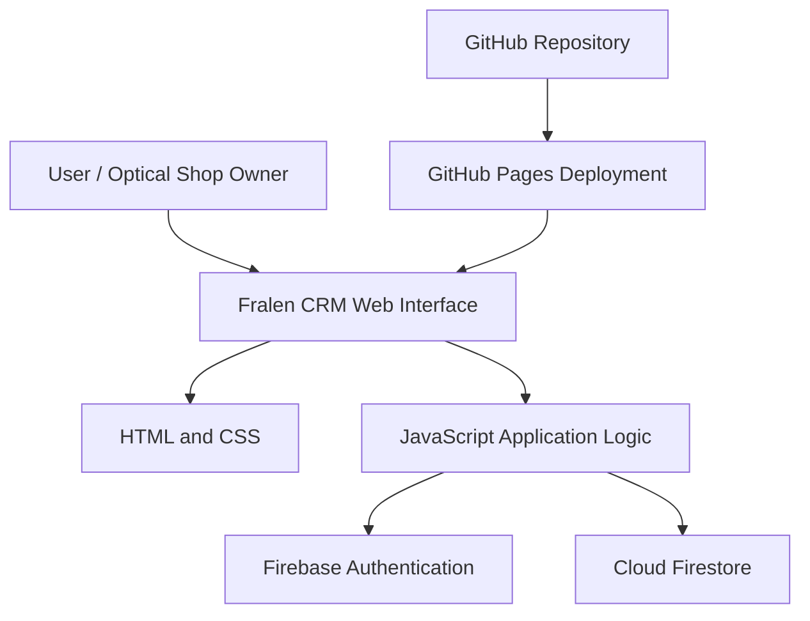

# 🧿 FRALEN CRM

### Smart Optical Shop Management System

**A modern, lightweight, Firebase-powered web application built to simplify optical retail operations through one centralized dashboard.**

Fralen CRM is designed for optical retailers who want to manage their daily business operations, organize product information, maintain customer relationships, and streamline store management using modern web technologies.

🌐 **Website:** https://fralencrm.in

---

<p align="center">
  
  
  
  
  
</p>

---

## 📖 Table of Contents

* [Overview](#-overview)
* [Key Features](#-key-features)
* [Technology Stack](#-technology-stack)
* [Application Architecture](#-application-architecture)
* [Project Structure](#-project-structure)
* [Getting Started](#-getting-started)
* [Firebase Configuration](#-firebase-configuration)
* [Security and Privacy](#-security-and-privacy)
* [Deployment](#-deployment)
* [Development Roadmap](#-development-roadmap)
* [Contributing](#-contributing)
* [License](#-license)
* [Contact](#-contact)

---

## 💎 Overview

Optical retailers manage multiple aspects of their business every day, including eyewear products, customer information, prescriptions, sales, orders, and customer follow-ups.

Managing these activities through disconnected tools or manual records can make daily operations unnecessarily complicated.

**Fralen CRM aims to bring optical shop management into one organized digital workspace.**

Built with HTML, CSS, JavaScript, and Firebase services, the application combines a lightweight frontend with cloud-backed data storage and authentication.

### 🎯 Our Mission

To empower optical retailers with practical, accessible, and modern digital tools that simplify store management, improve customer relationships, and support business growth.

### 👓 Who Is It For?

* Independent optical shop owners
* Eyewear retailers
* Optical store employees
* Growing optical retail businesses
* Businesses transitioning from manual records to digital management

---

## ✨ Key Features

### 🛍️ 1. Product Management

Organize optical products through a dedicated product management interface.

* Add product information through a dedicated form.
* Store supported product records in Cloud Firestore.
* Access product-related functionality through a collapsible navigation menu.
* Use pill-style sub-navigation for a cleaner interface.
* Keep product management accessible from the main application dashboard.

### 🔐 2. Firebase Authentication

Authentication functionality built around Firebase Authentication.

* User login and authentication workflows.
* Integration with Firebase authentication services.
* Foundation for account-based application access.
* Support for extending access control as the application evolves.

*Authentication does not automatically guarantee that database records are isolated between users. Appropriate authorization rules must also be configured.*

### 🌐 3. Public Landing Page

A dedicated public-facing website introducing Fralen CRM.

* Professional brand presentation.
* Feature-focused content.
* Navigation to relevant website pages.
* Search engine optimization foundations.
* JSON-LD structured data markup where configured.
* Custom favicon and brand identity.

### 📜 4. Privacy Policy

A dedicated privacy policy page intended to explain how the application handles information.

* Accessible privacy policy page.
* Clear navigation from the website.
* Foundation for communicating data handling practices.

The published policy should accurately reflect actual collection, processing, storage, retention, and sharing practices.

### 🎨 5. FRALEN Design System

A consistent visual identity designed for a professional optical retail platform.

* Navy and amber brand palette.
* Clear visual hierarchy.
* Consistent interface elements.
* Organized navigation and forms.
* Lightweight styling using CSS.

### ⚡ 6. Lightweight Frontend

Built using standard web technologies rather than requiring a heavy frontend framework.

* HTML for structure.
* CSS for styling.
* JavaScript for application logic.
* Firebase integration for supported backend functionality.
* Static hosting compatibility for the public website.

### 🚀 Future Expansion

Fralen CRM can be extended with additional optical retail workflows, including customer management, prescription records, order tracking, loyalty programs, marketing campaigns, and business analytics as these features are implemented and tested.

---

## 🧰 Technology Stack

| Layer             | Technology              | Purpose                          |
| ----------------- | ----------------------- | -------------------------------- |
| Frontend          | HTML5                   | Page structure                   |
| Styling           | CSS3                    | Layout and visual design         |
| Application Logic | JavaScript              | Interactions and business logic  |
| Database          | Cloud Firestore         | Cloud-based document storage     |
| Authentication    | Firebase Authentication | User authentication              |
| Hosting           | GitHub Pages            | Static website deployment        |
| Version Control   | Git and GitHub          | Source code management           |
| SEO               | JSON-LD                 | Structured data where configured |

### Why This Stack?

**Lightweight:** Standard web technologies keep the frontend straightforward.

**Cloud-powered:** Firebase provides managed backend services for supported application features.

**Developer-friendly:** Git and GitHub support source control and collaborative development.

**Deployment-friendly:** GitHub Pages can serve the static frontend while Firebase provides the configured backend services.

---

## 🏗️ Application Architecture

The application uses a web frontend connected to Firebase services for the functionality implemented in the project.



### Architecture Overview

* **Frontend:** Renders the application interface and handles supported user interactions.
* **Firebase Authentication:** Handles configured user authentication workflows.
* **Cloud Firestore:** Stores application records according to the implemented data model and security rules.
* **GitHub:** Maintains source code and version history.
* **GitHub Pages:** Publishes the static website frontend.

*The architecture diagram represents the intended high-level structure. Actual connections and features depend on the current codebase and Firebase configuration.*

---

## 📁 Project Structure

The following is an illustrative structure for a lightweight HTML, CSS, JavaScript, and Firebase application. Adjust it to match your actual repository files.

```text
CRMpro/
│
├── index.html
├── README.md
├── privacy-policy.html
├── favicon.ico
│
├── css/
│   └── style.css
│
├── js/
│   ├── app.js
│   ├── firebase-config.js
│   └── auth.js
│
├── assets/
│   ├── images/
│   ├── icons/
│   └── logos/
│
└── .gitignore
```

**Important:** The filenames and folders above are examples, not a verified inventory of your repository. Keep your existing project structure if it differs.

---

## 💻 Getting Started

Follow these steps to explore or run the project locally.

### Prerequisites

* A modern web browser.
* Git, if you want to clone the repository.
* A code editor such as Visual Studio Code.
* Access to a Firebase project if the application requires Firebase services.

### 1. Clone the Repository

Replace `YOUR_USERNAME` with the GitHub account or organization that owns your repository.

```bash
git clone https://github.com/YOUR_USERNAME/CRMpro.git
cd CRMpro
```

### 2. Open the Project

Open the cloned folder in your preferred code editor.

If the application consists of static HTML files, you can open the main HTML file in a browser. A local development server is generally preferable when testing JavaScript modules and browser security restrictions.

For Visual Studio Code:

1. Open the project folder.
2. Install the Live Server extension if needed.
3. Open the main HTML file.
4. Start Live Server.

### 3. Configure Firebase

If your application depends on Firebase, configure the required Firebase services before testing authentication or database operations.

See the next section for configuration and security guidance.

---

## 🔥 Firebase Configuration

Fralen CRM uses Firebase services for the backend functionality described in this README.

### Firebase Services

* **Firebase Authentication:** User sign-in workflows.
* **Cloud Firestore:** Document-based data storage.

Enable only the services actually required by your application.

### Web Configuration

For a standard Firebase web application, configuration may contain values such as:

```javascript
const firebaseConfig = {
  apiKey: "YOUR_FIREBASE_WEB_API_KEY",
  authDomain: "YOUR_PROJECT.firebaseapp.com",
  projectId: "YOUR_PROJECT_ID",
  storageBucket: "YOUR_STORAGE_BUCKET",
  messagingSenderId: "YOUR_MESSAGING_SENDER_ID",
  appId: "YOUR_APP_ID"
};
```

This is an illustrative example. Use the actual values from your Firebase project.

Firebase web configuration is normally included in client-side applications. The API key is not a substitute for security rules, authentication, or authorization.

**Never publish private service-account credentials, private signing keys, passwords, or privileged server secrets in frontend code or a public GitHub repository.**

### Database Security

Before using the application with real customer information:

* Configure and test Cloud Firestore Security Rules.
* Restrict access to authorized users.
* Ensure users cannot read or modify another shop's records without permission.
* Validate important operations on trusted server-side components when necessary.
* Review Firebase Authentication settings and authorized domains.
* Monitor usage and configure appropriate billing controls.

---

## 🔒 Security and Privacy

Security is essential for any application handling customer and business information.

Fralen CRM should follow these practices as the application develops:

* Use HTTPS for production website access.
* Apply appropriate authentication and authorization.
* Keep confidential credentials out of version control.
* Use least-privilege access rules.
* Avoid storing unnecessary sensitive customer information.
* Protect prescription and customer records against unauthorized access.
* Validate user input and sensitive database operations.
* Test security rules before deploying changes.
* Avoid including customer data in public screenshots, logs, or issue reports.

**Security note:** A working login page alone does not make a Firebase database secure. Enforce access restrictions through Firebase Security Rules and other appropriate backend controls.

---

## 🌍 Deployment

### Website

🌐 **Live website:** https://fralencrm.in

The public website is intended to be hosted through GitHub Pages, with Firebase services providing backend functionality where configured.

### GitHub Pages Deployment

1. Open the project repository on GitHub.
2. Navigate to **Settings → Pages**.
3. Confirm the publishing source and branch.
4. Verify that the required website files are included.
5. Configure the custom domain if necessary.
6. Configure DNS records with your domain provider.
7. Enable HTTPS when available.
8. Test the website and its Firebase-dependent features after deployment.

### Deployment Checklist

* [ ] Website loads correctly.
* [ ] Custom domain resolves correctly.
* [ ] HTTPS is enabled.
* [ ] Authentication works on the deployed domain.
* [ ] Firebase authorized domains are configured correctly.
* [ ] Firestore Security Rules are tested.
* [ ] Navigation and links work.
* [ ] Mobile layout is checked.
* [ ] No private credentials or customer data are committed.

---

## 🗺️ Development Roadmap

Potential future improvements for the Fralen CRM ecosystem include:

* [ ] Expanded customer relationship management.
* [ ] Optical prescription history and management.
* [ ] Sales reporting and business analytics.
* [ ] Order status notifications and tracking links.
* [ ] Customer follow-up automation.
* [ ] WhatsApp communication workflows.
* [ ] Loyalty cards and reward management.
* [ ] QR-based review assistance.
* [ ] Promotional campaign and poster creation.
* [ ] Excel-based data migration.
* [ ] Subscription and account administration.
* [ ] Additional accessibility and security improvements.

These items describe potential development directions. They should be marked as completed only after implementation and testing.

---

## 🤝 Contributing

Suggestions, bug reports, and improvements can help make Fralen CRM better.

### Contribution Guidelines

1. Review the existing project structure.
2. Create a separate branch for your changes.
3. Make focused and maintainable modifications.
4. Test affected functionality.
5. Avoid introducing private credentials or real customer data.
6. Submit a pull request if contributions are enabled for the repository.

For a privately maintained production repository, changes should be reviewed by the project owner before deployment.

---

## 🐛 Bug Reports

When reporting an issue, provide:

* A clear problem description.
* Steps to reproduce the issue.
* Expected and actual behavior.
* Browser and device information.
* Relevant error messages, with confidential information removed.

Never publish passwords, private keys, authentication tokens, or customer prescription records in a public issue.

---

## 📄 License

The license for this project should match the license file included in the repository.

If the repository contains an MIT license, you may use the following badge:


If no license has been added, do not claim that the project is MIT-licensed. Adding an MIT badge alone does not grant permission to reuse the source code.

---

## 💼 About FRALEN

**FRALEN CRM** is focused on making optical retail management more organized, accessible, and efficient through modern web technology.

Our vision is to provide optical shop owners with practical digital tools that help them manage everyday operations and build lasting customer relationships.

🌐 **Website:** https://fralencrm.in

---

<p align="center">
  <strong>🧿 FRALEN CRM</strong><br>
  Smarter Optical Retail. Simpler Business Management.
</p>
